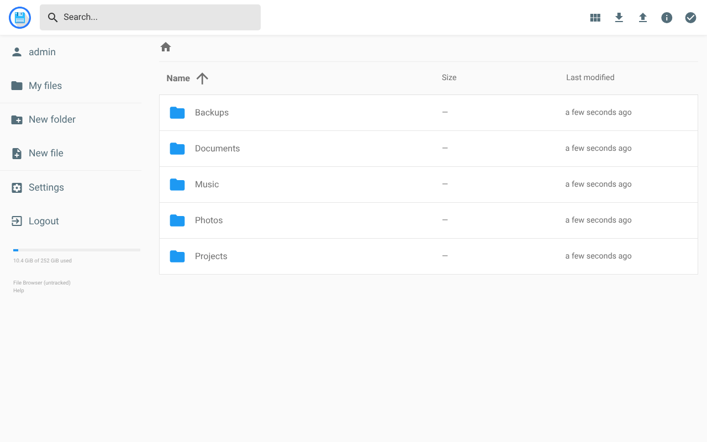
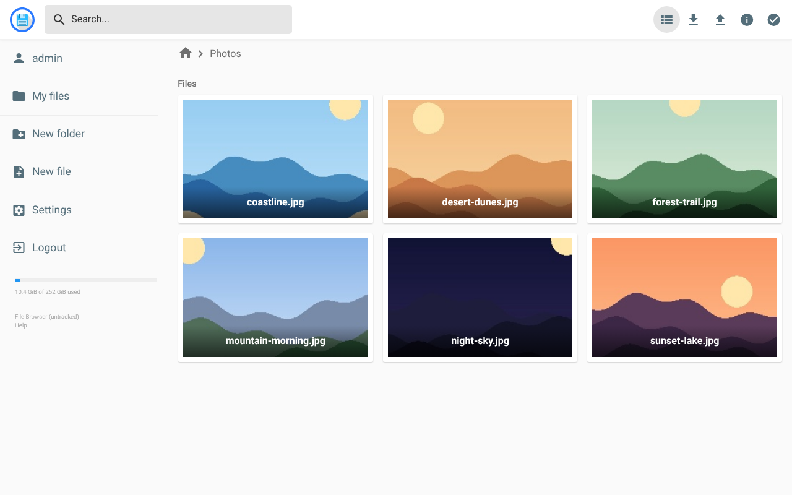
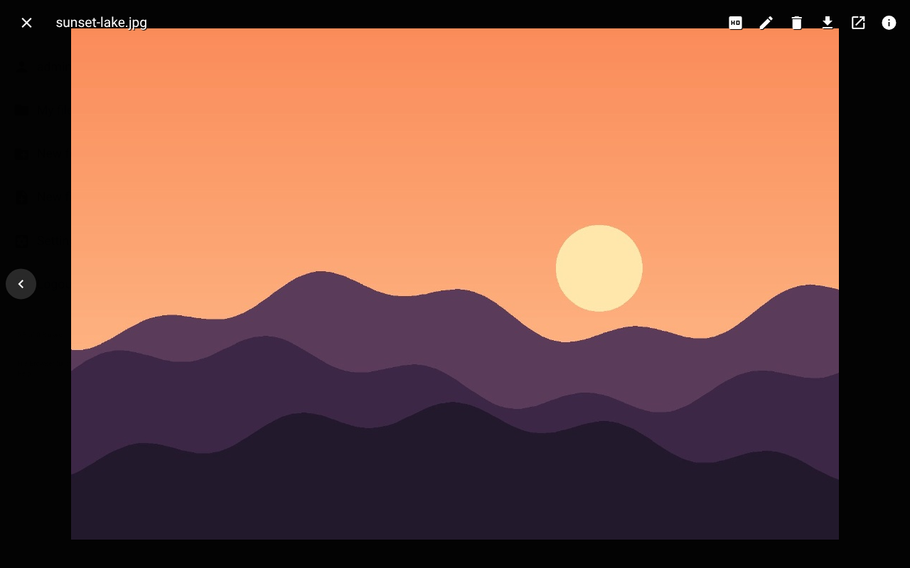
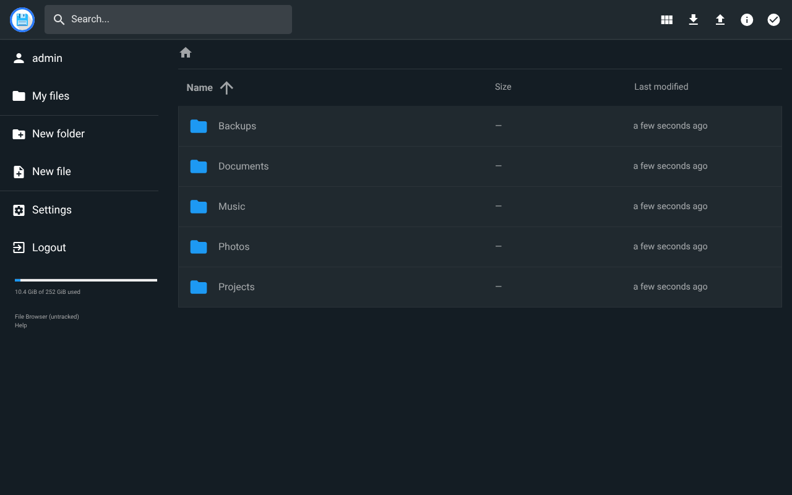
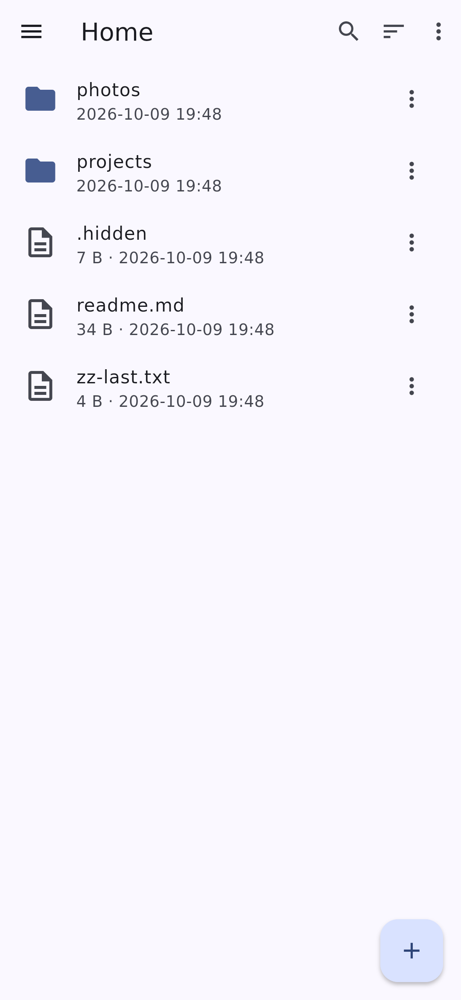
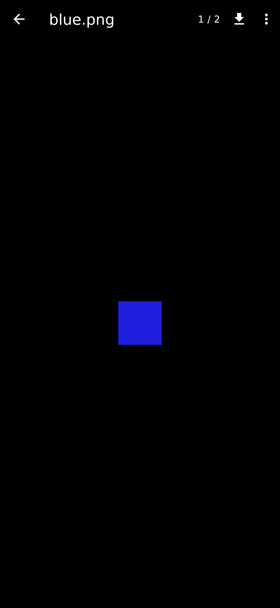
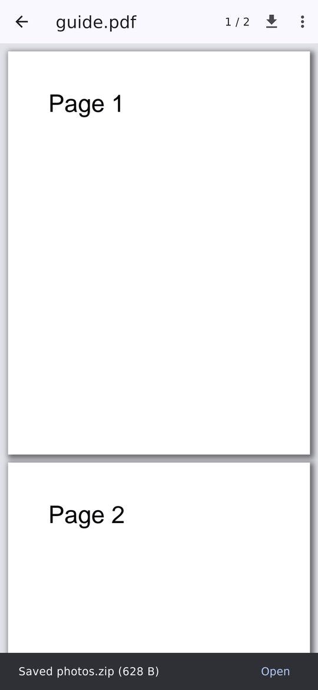
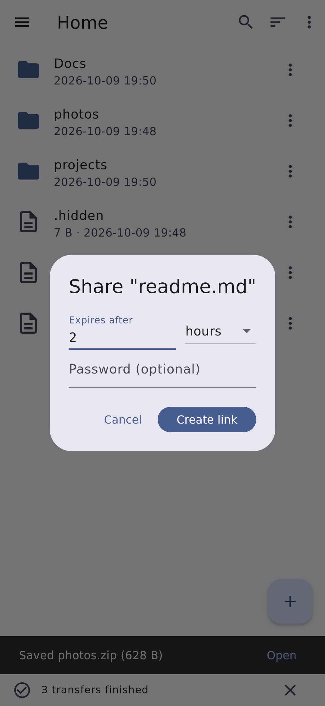
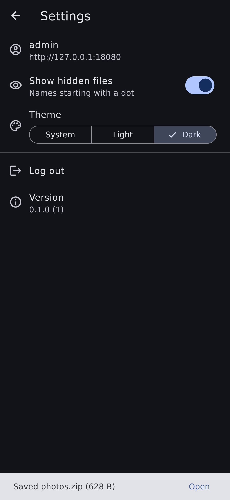

> [!NOTE]
>
> **This is a personal fork, maintained by [Paul Buetow](https://github.com/snonux).** Upstream
> [File Browser](https://github.com/filebrowser/filebrowser) was archived on 2026-09-01 and receives no
> further releases or fixes. I keep it going here for my own use: it carries security fixes made after
> the archive and a native Android client. I haven't bothered renaming it yet, so it is still called
> File Browser everywhere; that may change later.

  

File Browser provides a file managing interface within a specified directory and it can be used to upload, delete, preview and edit your files. It is a **create-your-own-cloud**-kind of software where you can just install it on your server, direct it to a path and access your files through a nice web interface.

**Background on the upstream archive:** [Goodbye File Browser, for Real This Time](https://hacdias.com/2026/07/28/filebrowser/), July 2026.

## What this fork adds

- **Security fixes** made after the upstream archive, included in server release `v2.63.24` and later. See [Security](#security).
- **A native Android client** in [`filebrowser-android/`](filebrowser-android), installable through F-Droid. See [Android client](#android-client).

## Screenshots

### Web interface

| File listing | Photo gallery |
| --- | --- |
|  |  |
| **Image preview** | **Dark theme** |
|  |  |

### Android app

| Browsing | Image viewer | PDF viewer | Share link | Settings |
| --- | --- | --- | --- | --- |
|  |  |  |  |  |

## Android client

[`filebrowser-android/`](filebrowser-android) is a Flutter app (`org.buetow.filebrowser`) that talks to the
server's existing REST API, so it works with an unmodified File Browser server. It browses, previews images,
PDFs, video and audio, edits text files, uploads (resumable, via tus), downloads, manages files, searches,
and creates share links with the web UI's options. Its [README](filebrowser-android/README.md) has the full
feature list and build instructions.

Install it from my F-Droid repository, which also delivers updates:
[snonux/fdroid](https://github.com/snonux/fdroid) (repository address `https://snonux.github.io/fdroid/repo`).
App releases are tagged `android-vX.Y.Z`; the server keeps the `vX.Y.Z` tags.

## Security

This fork carries security fixes made after the upstream archive (last upstream release: v2.63.23); build from
a `v2.63.24` or later release tag (see [CONTRIBUTING.md](CONTRIBUTING.md)) to get them. Upstream's published advisories
are listed under [security advisories](https://github.com/filebrowser/filebrowser/security/advisories), and reporting
instructions are in [SECURITY.md](SECURITY.md).

As this is a one-person fork, run it defensively: keep the command runner disabled (it is off by default), run it
unprivileged, and put it behind a reverse proxy instead of exposing it directly to the internet.

## Documentation

Documentation on how to install, configure, and build this project lives in [`docs`](docs) in this repository.

[CONTRIBUTING.md](CONTRIBUTING.md) documents how to build and develop the project.

## License

[Apache License 2.0](LICENSE) © File Browser Contributors
